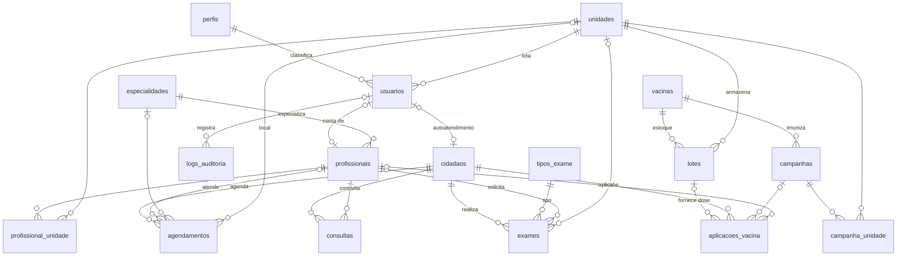

# Banco de dados — UPA 24H

- **SGBD:** MySQL / MariaDB 10.4 (XAMPP)
- **Banco:** `upa24h`
- **Scripts:** pasta `database/`
- **Tabelas:** 17
- **Chaves estrangeiras:** 29

## Diagrama entidade-relacionamento



## Relacionamentos exigidos

| Tipo | Onde |
|---|---|
| **N:N** | `profissionais` ↔ `unidades`, pela tabela associativa **`profissional_unidade`**. Um médico atende nas duas unidades, e cada unidade tem vários profissionais. A chave primária é composta: `(profissional_id, unidade_id)`. |
| **N:N** | `campanhas` ↔ `unidades`, pela tabela associativa **`campanha_unidade`**. |
| **1:N** | `perfis` → `usuarios`; `cidadaos` → `agendamentos`, `consultas`, `exames` e `aplicacoes_vacina`; `vacinas` → `lotes` e `campanhas`; `lotes` → `aplicacoes_vacina`; `especialidades` → `profissionais`; `unidades` → `agendamentos` e `lotes`; `usuarios` → `logs_auditoria`. |
| **1:1** (opcional) | `usuarios` ↔ `cidadaos` e `usuarios` ↔ `profissionais`. A coluna `usuario_id` é única, porque a conta de acesso pertence a uma única pessoa. |

## Tabelas

| Tabela | Conteúdo |
|---|---|
| `perfis` | Administrador, Profissional da Saúde, Recepção, Cidadão e Paciente |
| `usuarios` | Contas de acesso. O CPF é único e a senha é guardada como hash PBKDF2-SHA256 |
| `unidades` | Unidade Centro e Unidade Julia |
| `especialidades`, `tipos_exame`, `vacinas` | Catálogos. `vacinas` guarda também o estoque mínimo |
| `profissionais` | Médicos e equipe de enfermagem |
| `cidadaos` | Pacientes. O CPF é único |
| `agendamentos`, `consultas`, `exames` | Atendimento |
| `campanhas`, `lotes`, `aplicacoes_vacina` | Vacinação: campanhas, estoque por lote e doses aplicadas |
| `logs_auditoria` | Trilha de auditoria. Os registros são só inseridos e nunca apagados pela aplicação |
| `profissional_unidade`, `campanha_unidade` | Associativas N:N |

A coluna `dados` (JSON) de algumas tabelas guarda detalhes usados só pela
interface, como a classe de cor do status. Tudo o que participa de
relacionamentos, filtros e relatórios fica em colunas próprias, com tipo
adequado (`DATE`, `TIME`, `INT`) e chave estrangeira.

## Como a aplicação usa o banco

1. **Login.** O backend valida o CPF ou e-mail e a senha na tabela `usuarios`
   e abre a sessão PHP. A tentativa, com sucesso ou falha, fica em `logs_auditoria`.
2. **Carga dos dados.** `GET backend/api.php/sync` executa um SELECT com JOINs
   em cada tabela e devolve só o que o perfil pode ver. O Cidadão, por exemplo,
   recebe apenas os próprios agendamentos, consultas e exames.
3. **Gravação.** Cada alteração feita nas telas é enviada por
   `PUT backend/api.php/sync/{coleção}`. O repositório da tabela converte os
   nomes em chaves estrangeiras (médico → `profissional_id`, unidade →
   `unidade_id`…), confere a permissão do perfil e grava com
   `INSERT … ON DUPLICATE KEY UPDATE`, dentro de uma transação.
4. **Relatórios.** `backend/relatorio.php?tipo=...` monta o documento a partir
   de consultas SQL com JOIN. Só a equipe (Administrador, Profissional e
   Recepção) pode gerar relatórios.

## Relatórios

| Relatório | Formato | Junção |
|---|---|---|
| Ficha de atendimento do cidadão | **Mestre-detalhe.** O mestre é o cidadão; os detalhes são os agendamentos, exames e vacinas | `cidadaos` ⋈ `usuarios`; `agendamentos` ⋈ `profissionais` ⋈ `especialidades` ⋈ `unidades`; `exames` ⋈ `tipos_exame`; `aplicacoes_vacina` ⋈ `lotes` ⋈ `vacinas` |
| Agendamentos por período | Lista com filtros (período, unidade, profissional, status) e totais com `GROUP BY` | `agendamentos` ⋈ `cidadaos` ⋈ `profissionais` ⋈ `especialidades` ⋈ `unidades` |
| Estoque de vacinas por lote | **Mestre-detalhe.** O mestre é o lote, com a situação do estoque; o detalhe são as doses aplicadas | `lotes` ⋈ `vacinas` ⋈ `unidades`; `aplicacoes_vacina` ⋈ `cidadaos` ⋈ `profissionais` |

## Exemplos de consulta (para demonstrar no phpMyAdmin)

```sql
-- N:N: em quais unidades cada profissional atende
SELECT p.nome AS profissional, GROUP_CONCAT(u.nome ORDER BY u.nome SEPARATOR ', ') AS unidades
FROM profissionais p
JOIN profissional_unidade pu ON pu.profissional_id = p.id
JOIN unidades u ON u.id = pu.unidade_id
GROUP BY p.id ORDER BY p.nome;

-- 1:N: agendamentos por cidadão
SELECT c.nome, COUNT(a.id) AS agendamentos
FROM cidadaos c LEFT JOIN agendamentos a ON a.cidadao_id = c.id
GROUP BY c.id ORDER BY agendamentos DESC;

-- Mestre-detalhe: lotes e doses aplicadas
SELECT l.numero_lote, v.nome AS vacina, un.nome AS unidade, ap.data_hora, c.nome AS cidadao, ap.dose
FROM lotes l
JOIN vacinas v ON v.id = l.vacina_id
JOIN unidades un ON un.id = l.unidade_id
LEFT JOIN aplicacoes_vacina ap ON ap.lote_id = l.id
LEFT JOIN cidadaos c ON c.id = ap.cidadao_id
ORDER BY l.numero_lote, ap.data_hora;
```
